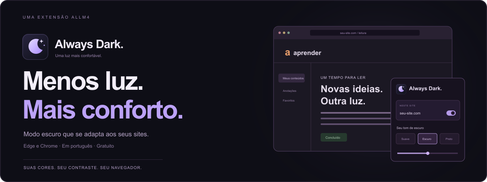

<p align="center">
  
</p>

<h1 align="center">Always Dark</h1>

<p align="center">
  Modo escuro que se adapta aos sites que você usa.<br />
  <strong>Contraste para ler. Cores para continuar reconhecendo.</strong><br />
  Gratuito, em português, para Microsoft Edge e Google Chrome.
</p>

<p align="center">
  <strong><a href="#instalação">Instalar a extensão</a></strong>
  &nbsp; · &nbsp;
  <a href="docs/guia.md">Guia de uso</a>
  &nbsp; · &nbsp;
  <a href="docs/site.md">Experimentar o site local</a>
  &nbsp; · &nbsp;
  <a href="https://github.com/Benfic4rthur/AlwaysDarkMode/issues">Relatar um problema</a>
</p>

---

## Seu site de sempre, com outra luz

Abra o painel e ative **Neste site**. O Always Dark adapta fundos, textos, bordas e campos, preservando a estrutura da página. Suas escolhas ficam salvas para as próximas visitas.

Foi pensado para se adaptar a qualquer site, do ambiente de estudo ao trabalho. O motor analisa as cores da própria página; não depende de uma lista de regras para sites específicos. Há [limites do navegador e do tipo de conteúdo](docs/guia.md#cobertura-e-limites).

| Recurso | Como funciona |
| --- | --- |
| **Modo escuro por site** | Ative onde quiser. Os demais sites continuam com seu tema original. |
| **Três tons de escuro** | Suave, Escuro e Preto, com brilho, contraste e luz quente ajustáveis. |
| **Cores que continuam fazendo sentido** | Fundos, textos, controles e bordas se adaptam juntos. |
| **Fotos e vídeos preservados** | Não há um filtro global invertendo os pixels de toda a página. |
| **Logos legíveis** | Traços neutros escuros sobre transparência podem ser clareados, mantendo as partes coloridas. |
| **Preferências lembradas** | Cada site guarda sua própria combinação. Temas escuros nativos podem ser preservados. |
| **Conteúdo dinâmico** | Acompanha mudanças na página, formulários, componentes e iframes autorizados. |

## Instalação

Você pode usar a pasta [`extension/`](extension/) deste repositório. Ela já contém o pacote pronto, incluindo ícones e painel. **Não é necessário instalar Node.js ou rodar um servidor para usar a extensão.**

| Microsoft Edge | Google Chrome |
| --- | --- |
| Abra `edge://extensions` | Abra `chrome://extensions` |
| Ative **Modo do desenvolvedor** | Ative **Modo do desenvolvedor** |
| Clique em **Carregar sem pacote** | Clique em **Carregar sem compactação** |

1. Baixe o código em **Code → Download ZIP**, extraia e guarde a pasta em um lugar fixo.
2. No navegador, selecione a pasta **`extension`**, que contém `manifest.json`.
3. Fixe o ícone da lua na barra, abra um site e ligue **Neste site** no painel.

A distribuição é manual e ainda não está nas lojas dos navegadores. Para atualizar, substitua os arquivos da pasta instalada e clique em **Recarregar** no cartão da extensão. Mantenha essa pasta no lugar.

**Atalho do painel:** `Alt + Shift + D` no Windows/Linux ou `Option + Shift + D` no Mac. Os atalhos podem ser personalizados nas configurações de extensões do navegador.

## Do seu jeito, em cada site

No painel, escolha **Suave**, **Escuro** ou **Preto**. Ajuste o brilho, o contraste e a luz quente até encontrar uma leitura confortável. **Restaurar** volta aos ajustes padrão daquele site.

Com **Respeitar o tema do site**, páginas que já são escuras mantêm sua aparência. Ao desligar a extensão para um domínio, as cores originais voltam sem precisar recarregar.

Leia o [guia de uso](docs/guia.md) para conhecer o escopo da ativação, os controles e os limites.

## Leveza e privacidade

- O pacote instalado tem aproximadamente **150 KiB**, com o motor, o painel e os ícones locais. Esse valor é tamanho em disco, não consumo de memória de uma aba.
- Sites não ativados não recebem o motor. O worker Manifest V3 funciona por eventos e pode dormir quando ocioso.
- Não há conta, anúncios, telemetria, rastreamento ou IA remota. As preferências ficam em `chrome.storage.local`.
- Os recursos necessários à adaptação de estilos e imagens vêm das próprias páginas e suas CDNs. Não há servidor da extensão recebendo o conteúdo das páginas.
- A análise de logos usa amostras pequenas e cache limitado. Fotos, avatares e imagens opacas são preservados.
- O trabalho em uma página ativa depende do tamanho e das mudanças produzidas pelo próprio site. Não há consulta periódica de abas.

As permissões são `activeTab`, `scripting` e `storage`, com acesso HTTP/HTTPS para adaptar as páginas e ler estilos/imagens das suas origens. Consulte o [manifesto](extension/manifest.json) e os [detalhes técnicos](docs/desenvolvimento.md).

## Experimentar sem instalar

O site inclui uma demonstração ilustrativa de ligar/desligar o tema, trocar os tons e ajustar o brilho.

```sh
npm run site
```

Abra **http://127.0.0.1:4173/**. O site roda somente no computador, com os assets locais e o pacote da extensão. [Veja o guia do site](docs/site.md).

## Para quem quer olhar por dentro

| Diretório | Conteúdo |
| --- | --- |
| [`extension/`](extension/) | Extensão pronta para instalar, painel, ícones e licença do motor. |
| [`src/`](src/) | Código-fonte do worker, conteúdo, painel e análise genérica de contraste. |
| [`site/`](site/) | Página local de apresentação, demonstração interativa e instalação. |
| [`tests/`](tests/) | Verificações de configuração, contraste, restauração, componentes e ociosidade. |
| [`scripts/`](scripts/) | Build, ícones, empacotamento e servidor local do site. |
| [`docs/`](docs/) | Guias de uso, desenvolvimento e site. |

**[Desenvolver e testar](docs/desenvolvimento.md)** · **[Guia de uso](docs/guia.md)** · **[Site local](docs/site.md)** · **[Relatar um problema](https://github.com/Benfic4rthur/AlwaysDarkMode/issues)**

Os testes e as imagens de apresentação são produzidos localmente. **GitHub Actions está desativado neste repositório**; não há workflows de build, testes ou publicação consumindo a franquia do proprietário.

O motor de cores usa o [Dark Reader](https://github.com/darkreader/darkreader), sob licença MIT, incluída no pacote. As fontes da página usam a licença SIL Open Font License, também incluída.

---

<p align="center">
  Feito pela <a href="https://allm4.com/">ALLM4</a>.<br />
  <sub>Conheça também <a href="https://allm4.com/canalnongrato/">CanalNonGrato</a> e <a href="https://allm4.com/tubeorder/">TubeOrder</a>.</sub><br />
  <sub>Projeto independente, sem vínculo com Microsoft ou Google.</sub>
</p>
